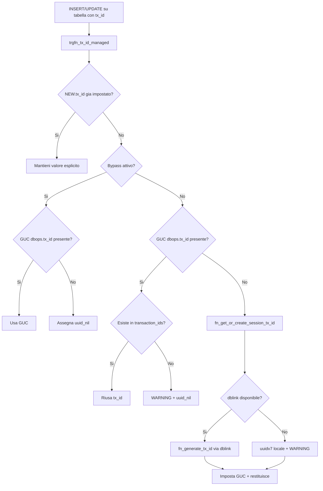
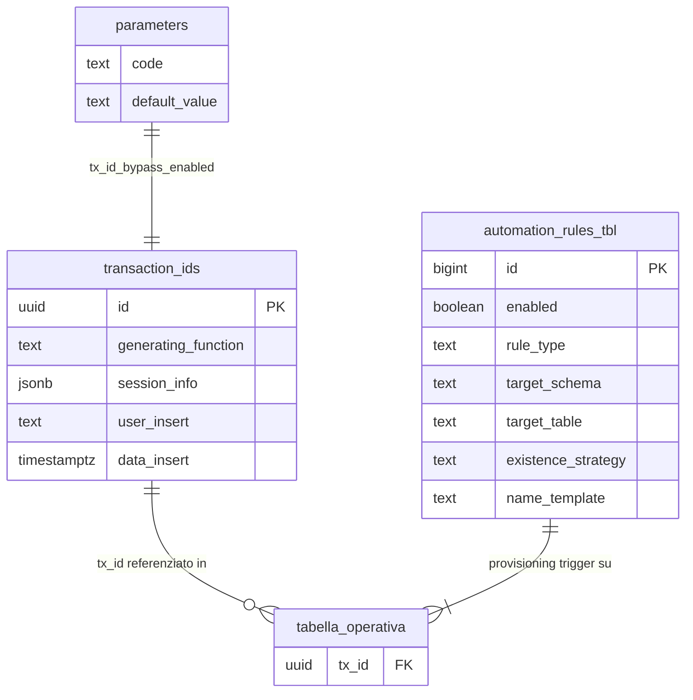

# Guida — Gestione del Transaction ID (`tx_id`)

> **Ultimo aggiornamento**: 4 novembre 2026
>
> **Destinatari**: sviluppatori database e backend
>
> **Vedi anche** — schemi DB:
>
> * [dbops.transaction_ids](/dbzero/dbops/tabelle/transaction_ids) — il registro master dei `tx_id` generati
> * [dbops.automation_rules_tbl](/dbzero/dbops/tabelle/automation_rules_tbl) — le regole del provisioning automatico dei trigger
> * [config.parameters](/dbzero/config/tabelle/parameters) — il parametro `tx_id_bypass_enabled`
>
> **Vedi anche** — funzioni e trigger DB:
>
> * [dbops.trgfn_tx_id_managed](/dbzero/dbops/funzioni/trgfn_tx_id_managed) — la trigger function di gestione automatica
> * [dbops.fn_generate_tx_id](/dbzero/dbops/funzioni/fn_generate_tx_id) — generazione e registrazione di un nuovo `tx_id`
> * [dbops.fn_get_or_create_session_tx_id](/dbzero/dbops/funzioni/fn_get_or_create_session_tx_id) — recupero o creazione del `tx_id` di sessione
> * [dbops.fn_run_automations_tx_id](/dbzero/dbops/funzioni/fn_run_automations_tx_id) — il provisioning automatico dei trigger
> * [maintenance.proc_automations_tx_id_job](/dbzero/maintenance/funzioni/proc_automations_tx_id_job) — la procedura schedulata
>
> **Vedi anche** — guide correlate:
>
> * [Guida Automazione DB](/guide/automazione-db) — il framework di automazione
> * [Audit e tracciabilità](/guide/audit-e-tracciabilita) — le tre tracce e il loro filo conduttore
> * [Storicizzazione tabelle](/guide/storicizzazione-tabelle) — gli snapshot correlati dal `tx_id`
> * [Messaggi di errore e generazione log](/guide/Messaggi-di-Errore-e-Generazione-Log) — il logging degli errori con `tx_id`
> * [Messaggi di audit](/guide/messaggi-audit) — l'audit trail
> * [Configurazione e gestione parametri](/guide/configurazione-e-gestione-parametri) — il sistema parametri e GUC

---

## Introduzione

Questa guida descrive il sistema di identificazione transazionale (`tx_id`) di Zero ERP:
come viene generato, propagato, validato e automatizzato su tutte le tabelle del sistema.

In un sistema ERP che opera su decine di tabelle, schemi e processi concorrenti, poter correlare tutte le operazioni di una singola transazione e fondamentale per tracciabilita, debugging e audit.

Il `tx_id` e un UUID (formato UUIDv7, ordinabile cronologicamente) che identifica una transazione applicativa. Ogni riga inserita o aggiornata in una tabella che contiene la colonna `tx_id` riceve automaticamente questo identificativo tramite un trigger. Il valore e condiviso tra tutte le operazioni della stessa sessione, permettendo di ricostruire l'intera catena di modifiche con una singola query.

Il sistema non richiede intervento esplicito del backend: il trigger `trgfn_tx_id_managed` si occupa di tutto automaticamente. Tuttavia, il backend puo opzionalmente pre-impostare il `tx_id` di sessione per un controllo piu fine.

**Cosa troverai in questa guida:**

* La tabella registro `transaction_ids` e la sua struttura
* Le funzioni di generazione e recupero del `tx_id`
* Il trigger di gestione automatica e il suo flusso decisionale
* Il sistema di automazione per il provisioning dei trigger
* I parametri GUC e di configurazione coinvolti
* L'integrazione con il backend Django

---

## Il modello in sintesi

```text
config.parameters
└── tx_id_bypass_enabled          -- abilita/disabilita bypass globale

dbops
├── transaction_ids               -- registro master UUID generati (immutabile)
├── automation_rules_tbl          -- regole provisioning trigger (rule_type='TX_ID')
├── fn_generate_tx_id()           -- genera UUID + INSERT in transaction_ids
├── fn_get_or_create_session_tx_id()  -- riusa GUC o genera via dblink
├── trgfn_tx_id_managed()         -- trigger BEFORE INSERT/UPDATE su ogni tabella
└── fn_run_automations_tx_id()    -- crea trigger dove mancano

maintenance
└── proc_automations_tx_id_job()  -- wrapper schedulato con lock e logging

GUC
├── dbops.tx_id                   -- tx_id corrente (transaction-scoped)
├── myapp.bypass_tx_id_check      -- override bypass per sessione
└── myapp.dblink_log_connection   -- stringa di connessione dblink
```

---

## Registro: `transaction_ids`

La tabella `dbops.transaction_ids` e il registro centrale di tutti i transaction ID generati nel sistema. Ogni record e immutabile: una volta creato, non puo essere ne aggiornato ne cancellato (protetto da `trgfn_prevent_modification_generic`).

Da un punto di vista tecnico:

| Colonna               | Tipo        | Nullable | Default        | Descrizione                                          |
| --------------------- | ----------- | :------: | -------------- | ---------------------------------------------------- |
| `id`                  | UUID, PK    |    no    | `uuidv7()`     | Transaction ID (UUIDv7, ordinabile cronologicamente) |
| `generating_function` | TEXT        |    si    | —              | Nome della funzione che ha richiesto la generazione  |
| `session_info`        | JSONB       |    no    | `'{}'`         | Dati di contesto (utente, IP, fonte)                 |
| `user_insert`         | TEXT        |    no    | `CURRENT_USER` | Utente che ha creato il record                       |
| `data_insert`         | TIMESTAMPTZ |    no    | `now()`        | Timestamp di creazione                               |
| `user_update`         | TEXT        |    si    | —              | Sempre NULL (record immutabile)                      |
| `data_update`         | TIMESTAMPTZ |    si    | —              | Sempre NULL (record immutabile)                      |

**Protezione immutabilita:** trigger `trgfn_prevent_modification_generic` blocca UPDATE e DELETE.

> Documentazione dettagliata: [dbops.transaction_ids](/dbzero/dbops/tabelle/transaction_ids)

---

## Funzioni di generazione

### `fn_generate_tx_id` — generazione e registrazione

Questa funzione e il punto unico di creazione di un nuovo `tx_id`. Genera un UUIDv7, lo inserisce in `transaction_ids` con il contesto di chiamata, e lo restituisce. E dichiarata `SECURITY DEFINER` per permettere l'invocazione da ruoli con privilegi limitati.

Da un punto di vista tecnico:

| Parametro               | Tipo  | Default | Descrizione                             |
| ----------------------- | ----- | ------- | --------------------------------------- |
| `p_generating_function` | TEXT  | —       | Nome della funzione/processo chiamante  |
| `p_session_info`        | JSONB | `'{}'`  | Dati di contesto (utente, IP, sessione) |

**Restituisce:** `UUID` — il nuovo tx_id generato.

**Logica:**

1. Genera `v_tx := uuidv7()`
2. INSERT in `dbops.transaction_ids` con `id`, `generating_function`, `session_info`
3. Restituisce `v_tx`

> Documentazione dettagliata: [dbops.fn_generate_tx_id](/dbzero/dbops/funzioni/fn_generate_tx_id)

---

### `fn_get_or_create_session_tx_id` — recupero o creazione per sessione

Questa funzione e il punto d'ingresso consigliato sia per il trigger sia per il backend. Garantisce che all'interno di una sessione database tutte le operazioni condividano lo stesso `tx_id`, generandone uno nuovo solo se necessario.

E dichiarata `SECURITY DEFINER` e non accetta parametri.

Da un punto di vista tecnico:

**Restituisce:** `UUID` — il tx_id di sessione (mai NULL).

**Flusso di esecuzione:**

1. **Riuso GUC**: legge `current_setting('dbops.tx_id', true)`. Se esiste un UUID valido, lo restituisce immediatamente.

2. **Connessione di log**: chiama `script.fn_ensure_logconn()`, che apre o ritrova la connessione persistente `logconn`. Assorbe la connessione già aperta e il `too_many_connections`, **non** gli altri errori di connessione: se il canale è impostato ma la connessione non si apre (credenziali o servizio sbagliati, server irraggiungibile), l'errore esce dalla funzione e il trigger lo trasforma in `E_TXID_GENERATION`, che **blocca la scrittura**.

    ⚠️ L'interruttore `myapp.log_with_dblink` lo rispetta solo `fn_ensure_logconn`, che con `off` non apre `logconn`. La generazione (passo 4) passa comunque dalla stringa di connessione del canale: con l'interruttore spento il `tx_id` nasce lo stesso fuori transazione, aprendo una connessione nuova a ogni transazione.

3. **Verifica dblink**: legge `myapp.dblink_log_connection`. Se assente o vuota, WARNING e **ritorno della sentinella `script.uuid_nil()`, senza impostare la GUC**.

4. **Generazione via dblink**: chiama `dbops.fn_generate_tx_id` tramite dblink sulla connessione di log. È **l'unico percorso che registra** in `transaction_ids`, e lo fa su una connessione separata: la registrazione sopravvive al rollback della transazione principale.

5. **Ripiego su errore o NULL da dblink**: WARNING e ritorno della sentinella `uuid_nil()`, **senza impostare la GUC**.

6. **Impostazione GUC**: avviene **solo** quando l'id è stato registrato, e con **scope locale alla transazione** (`set_config(..., TRUE)`).

> ### La regola: non pubblicare mai un tx_id che non hai registrato
>
> La validazione di `trgfn_tx_id_managed` scatta **solo sull'id pubblicato nella
> GUC**. Pubblicando unicamente id venuti dal registro — e nel degrado non
> pubblicando affatto — l'invariante è vero per costruzione e il ramo «id non
> registrato» diventa irraggiungibile in condizioni normali.
>
> ⚠️ **Perché la regola è così stretta.** Un id **non registrato** pubblicato nella
> GUC fa fallire la prima scrittura tracciata: e poiché Liquibase usa una sola
> connessione, da lì in avanti fallisce l'intera migrazione. Non è un caso di
> laboratorio: è il modo in cui una pubblicazione sbagliata diventa un blocco.

**Catena di fallback:**

```text
GUC dbops.tx_id gia impostato?
  SI → riusa
  NO → dblink disponibile?
         SI → fn_generate_tx_id via dblink → registrato in transaction_ids
                                           → GUC impostata (scope transazione)
         NO → sentinella uuid_nil (WARNING)
                                           → GUC NON impostata
```

> Documentazione dettagliata: [dbops.fn_get_or_create_session_tx_id](/dbzero/dbops/funzioni/fn_get_or_create_session_tx_id)

---

## Trigger function: `trgfn_tx_id_managed`

Questa e la trigger function centrale del sistema. Viene eseguita `BEFORE INSERT OR UPDATE` su ogni tabella che contiene la colonna `tx_id`.

> **Non e `SECURITY DEFINER`.** Gira con i privilegi del ruolo che sta scrivendo
> la riga. E un dettaglio che conta: quando la scrittura arriva da un ruolo
> ristretto — per esempio la sessione `dblink` del canale di log, che ha i grant
> sul solo schema `dbops` — il trigger non puo toccare `config` o `script` senza
> incappare in «permesso negato». E la ragione dell'uscita anticipata descritta
> sotto (Fase 0).

Il suo compito e assegnare a `NEW.tx_id` un valore valido, seguendo un flusso decisionale che bilancia rigore (verifica del tx_id nel registro) e flessibilita (bypass configurabili per test e migrazioni).

Da un punto di vista tecnico:

**Flusso di esecuzione completo:**

### Fase 0 — Uscita anticipata quando il tx_id e gia fornito

Prima di ogni altra cosa, il trigger normalizza un eventuale `tx_id` "stringa
vuota" a `NULL` e poi, **se `NEW.tx_id` risulta gia valorizzato, ritorna
subito** (`RETURN NEW`) senza eseguire nulla di quanto segue.

E l'unica fase che quasi sempre decide l'esito quando il client pre-imposta il
tx_id. Il perche e semplice: tutte le fasi 1-4 servono solo a **calcolare un
valore da assegnare quando manca** — quel valore finisce nella `COALESCE`
finale, raggiunta unicamente se `NEW.tx_id IS NULL`. Se il valore c'e gia, quel
lavoro non cambierebbe il risultato.

Due conseguenze pratiche:

* Il trigger e installato su tutte le tabelle con la colonna `tx_id`: ogni
  scrittura che porta gia il proprio tx_id smette di leggere `config.parameters` e
  di attraversare i rami che chiamano `script.*`.
* Il canale di log (`fn_log_error_only` via `dblink`, che fornisce **sempre** il
  proprio tx_id) non richiede permessi su `config`/`script`: senza l'uscita
  anticipata quelle chiamate fallirebbero con «permesso negato per lo schema
  script», e l'errore non verrebbe persistito in `dbops.error_log`.

> **Nota sull'ordine.** La normalizzazione deve precedere l'uscita: invertirle
> lascerebbe passare un tx_id "stringa vuota". Per una colonna `UUID` quel caso
> e di fatto irraggiungibile, ma la logica resta dov'era.

### Fase 1 — Verifica bypass globale

Le fasi 1-5 si eseguono **solo se `NEW.tx_id` era NULL** (altrimenti la Fase 0 e
gia uscita).

Legge il parametro `tx_id_bypass_enabled` da `config.parameters`.

* Se il parametro non esiste: logga via `fn_log_error_only` e prosegue con bypass disabilitato.
* Se errore di lettura: logga via `fn_log_and_raise_error` e rilancia.

### Fase 2 — Override bypass di sessione

Se il bypass non e gia attivo, prova a leggere la GUC `myapp.bypass_tx_id_check`. Se impostata a `true`, abilita il bypass per questa invocazione. Errori di lettura sono ignorati.

### Fase 3 — Lettura tx_id di sessione

Legge `current_setting('dbops.tx_id', true)` per ottenere un eventuale tx_id gia presente in sessione.

### Fase 4 — Determinazione del valore

**Se bypass attivo:**

* Usa il tx_id di sessione se presente, altrimenti `script.uuid_nil()` (`00000000-...`)

**Se bypass disattivo:**

* **Se tx_id di sessione presente:** verifica l'esistenza in `dbops.transaction_ids`
  * Se trovato: lo riusa
  * Se non trovato: logga WARNING `W_TXID_NOT_REGISTERED` e assegna `uuid_nil()`
* **Se tx_id di sessione assente:** chiama `fn_get_or_create_session_tx_id()`
  * Se errore: logga `E_TXID_GENERATION` e assegna `uuid_nil()`

### Fase 5 — Assegnazione a `NEW.tx_id`

Si arriva qui solo con `NEW.tx_id` NULL (il caso "gia valorizzato" e uscito alla
Fase 0). L'assegnazione e:

`NEW.tx_id = COALESCE(GUC dbops.tx_id, v_new_tx_id, uuidv7())`

La catena COALESCE finale garantisce che `NEW.tx_id` non sia mai NULL, con `uuidv7()` come ultimo fallback.

> Documentazione dettagliata: [dbops.trgfn_tx_id_managed](/dbzero/dbops/funzioni/trgfn_tx_id_managed)

---

## Parametri GUC e configurazione

Il sistema tx_id si appoggia a una combinazione di parametri di sessione (GUC) e parametri applicativi persistenti.

### GUC di sessione (ambito: connessione corrente)

| GUC                           | Tipo    | Descrizione                                                                                                                                                                                                                                                                  |
| ----------------------------- | ------- | ---------------------------------------------------------------------------------------------------------------------------------------------------------------------------------------------------------------------------------------------------------------------------- |
| `dbops.tx_id`                 | UUID    | Transaction ID corrente. Impostato da `fn_get_or_create_session_tx_id` con **scope locale alla transazione** (`set_config(..., TRUE)`), letto da `trgfn_tx_id_managed`. **Contiene solo id registrati** in `dbops.transaction_ids`: nei ripieghi non viene impostata affatto |
| `myapp.bypass_tx_id_check`    | BOOLEAN | Override di sessione per disabilitare la validazione tx_id (utile in test/migrazioni)                                                                                                                                                                                        |
| `myapp.dblink_log_connection` | TEXT    | Stringa di connessione dblink per la generazione remota del tx_id                                                                                                                                                                                                            |

### Parametri applicativi (in `config.parameters`)

| Codice                 | Tipo    | Descrizione                                                                                                                   |
| ---------------------- | ------- | ----------------------------------------------------------------------------------------------------------------------------- |
| `tx_id_bypass_enabled` | BOOLEAN | Bypass globale della validazione tx_id. Se `true`, il trigger non genera ne verifica, usa il tx_id di sessione o `uuid_nil()` |

Il bypass ha due livelli: il parametro globale in `config.parameters` e l'override di sessione via GUC `myapp.bypass_tx_id_check`, che si legge solo se il parametro non è attivo. Basta che uno dei due sia `true` per attivare il bypass, **purché il parametro esista**: se `tx_id_bypass_enabled` manca da `config.parameters`, il trigger registra `E_ERRORE_PARAMETRI_TABELLA` senza sollevare, il bypass resta indefinito, anche l'override di sessione viene ignorato, e il bypass non scatta. Il dettaglio è in [dbops.trgfn_tx_id_managed](/dbzero/dbops/funzioni/trgfn_tx_id_managed).

---

## Automazione: provisioning dei trigger

### `fn_run_automations_tx_id` — scansione e creazione trigger

Questa funzione automatizza la creazione del trigger `trgfn_tx_id_managed` su tutte le tabelle che contengono una colonna `tx_id uuid`. E il componente che garantisce la copertura uniforme del sistema.

Da un punto di vista tecnico:

| Parametro     | Tipo    | Default | Descrizione                                                  |
| ------------- | ------- | ------- | ------------------------------------------------------------ |
| `p_exec_mode` | TEXT    | —       | Modalita: `AUTO`, `SCHEDULED`, `FORCE`                       |
| `p_schemas`   | TEXT[]  | —       | Schemi da processare. Se NULL, risolti da `fn_resolve_scope` |
| `p_dry_run`   | BOOLEAN | —       | Se true, simula senza creare trigger                         |

**Restituisce:** `void`

**Flusso logico:**

1. **Ambito**: risolve gli schemi target con `dbops.fn_resolve_scope`
2. **Scansione tabelle**: itera tutte le tabelle fisiche (`relkind='r'`) nell'ambito, filtrate da `fn_table_in_scope`
3. **Selezione regole**: per ciascuna tabella, filtra in `automation_rules_tbl` le regole con `rule_type='TX_ID'`, rispettando `enabled`, `exec_mode`, `priority` e pattern di match su schema/tabella
4. **Pre-condizione**: verifica che la tabella abbia una colonna `tx_id` di tipo `uuid` (non crea colonne, solo trigger)
5. **Naming**: genera il nome trigger dal template (default: `trg_{table}_gen_tx_id_ins_upd`) tramite `fn_name_from_template`
6. **Verifica esistenza**: controlla se il trigger esiste gia, con strategia configurabile:
    * `BY_NAME` — verifica per nome trigger
    * `BY_FUNCTION` — verifica per funzione trigger
    * `BOTH` — presente se almeno uno dei due e vero
7. **Azione**: se il trigger non esiste:
    * `p_dry_run = true` → registra evento `DRYRUN_CREATE_TRIGGER` via `fn_audit_log_once`
    * `p_dry_run = false` → crea il trigger `BEFORE INSERT OR UPDATE ... EXECUTE FUNCTION dbops.trgfn_tx_id_managed()`

> Documentazione dettagliata: [dbops.fn_run_automations_tx_id](/dbzero/dbops/funzioni/fn_run_automations_tx_id)

---

### Regole di automazione: `automation_rules_tbl`

Le regole di automazione sono configurate nella tabella `dbops.automation_rules_tbl`. Per il sistema tx_id, le regole hanno `rule_type = 'TX_ID'`.

| Colonna              | Tipo       | Default   | Descrizione                                                      |
| -------------------- | ---------- | --------- | ---------------------------------------------------------------- |
| `id`                 | BIGINT, PK | —         | Chiave primaria                                                  |
| `enabled`            | BOOLEAN    | true      | Regola attiva                                                    |
| `rule_type`          | TEXT       | —         | Tipo regola (es. `TX_ID`, `AUDIT`, `FK_INDEX`)                   |
| `target_schema`      | TEXT       | `*all`    | Schema target (pattern o `*all`)                                 |
| `target_table`       | TEXT       | `*all`    | Tabella target (pattern ILIKE o `*ALL`)                          |
| `exec_mode`          | TEXT       | `AUTO`    | Modalita: `AUTO`, `SCHEDULED`, `FORCE`                           |
| `name_template`      | TEXT       | —         | Template nome trigger (default: `trg_{table}_gen_tx_id_ins_upd`) |
| `existence_strategy` | TEXT       | `BY_NAME` | Strategia verifica: `BY_NAME`, `BY_FUNCTION`, `BOTH`             |
| `params`             | JSONB      | `'{}'`    | Parametri aggiuntivi                                             |
| `priority`           | INTEGER    | 100       | Ordine di applicazione (minore = prima)                          |
| `note`               | TEXT       | —         | Note descrittive                                                 |

> Documentazione dettagliata: [dbops.automation_rules_tbl](/dbzero/dbops/tabelle/automation_rules_tbl)

---

### `proc_automations_tx_id_job` — esecuzione schedulata

La procedura `maintenance.proc_automations_tx_id_job` incapsula l'esecuzione di `fn_run_automations_tx_id` in un wrapper robusto con advisory lock e logging strutturato tramite `maintenance.fn_run_and_log`.

Da un punto di vista tecnico: la chiamata diretta, e ciò a cui equivale, stanno
nell'[Area tecnica](#area-tecnica-esempi).

**Caratteristiche:**

* **Advisory lock**: chiave derivata da `hashtext('automations_tx_id')`, previene esecuzioni parallele
* **Logging**: registra inizio, fine, esito (OK/KO) e dettagli in `maintenance.job_run_log`
* **Idempotenza**: puo essere chiamata piu volte senza duplicazioni (i trigger esistenti non vengono ricreati)

**Scheduling consigliato:** via pgAgent o cron, in finestra di bassa attivita (es. 02:50 notturno).

> Documentazione dettagliata: [maintenance.proc_automations_tx_id_job](/dbzero/maintenance/funzioni/proc_automations_tx_id_job)

---

## Integrazione con il backend Django

In Zero ERP il trigger `trgfn_tx_id_managed` gestisce automaticamente il `tx_id` senza intervento del backend. Tuttavia, per una correlazione piu precisa, il backend Django puo pre-impostare il tx_id di sessione all'apertura della connessione.

### Approccio consigliato

Il backend esegue una volta per sessione/richiesta la chiamata che sta
nell'[Area tecnica](#area-tecnica-esempi).

Questo imposta la GUC `dbops.tx_id` per tutte le operazioni successive nella stessa connessione. Il trigger `trgfn_tx_id_managed` trovera il valore gia in sessione e lo riusera senza rigenararlo.

> Diverso dal pre-impostare **la colonna** `NEW.tx_id` sulla singola riga: quello
> attiva l'uscita anticipata del trigger (Fase 0), che salta del tutto il
> percorso di generazione. Pre-impostare la **GUC di sessione**, invece,
> attraversa le fasi 1-5 la prima volta e poi riusa il valore. Per la
> correlazione request/task e la GUC lo strumento giusto.

### Quando pre-impostare il tx_id

* **Richieste API**: all'inizio della request, per correlare tutte le operazioni della stessa chiamata
* **Task asincroni**: all'inizio del task, per correlare le operazioni del batch
* **Migrazioni/import**: per identificare le righe inserite da un singolo processo

### Quando non e necessario

Se il backend non imposta il tx_id, il trigger lo genera automaticamente alla prima operazione sulla tabella. Il tx_id viene poi condiviso con le operazioni successive nella stessa sessione tramite la GUC.

---

## Regole di dominio

1. **Colonna `tx_id` nullable**: la colonna e dichiarata `UUID` nullable nelle tabelle operative. Il trigger la popola automaticamente; il valore non e mai NULL dopo l'esecuzione del trigger.

2. **Unicita per transazione**: la GUC `dbops.tx_id` è impostata con scope **locale alla transazione** (`set_config(..., TRUE)`), quindi tutte le operazioni della stessa transazione condividono il `tx_id` e ogni nuova transazione ne ottiene uno proprio. È coerente col nome: un identificativo *di transazione* non deve sopravvivere alla transazione. Lo scope di **sessione** — un solo `tx_id` per connessione — renderebbe invece **permanente** l'effetto di un ripiego andato male, ed è per questo che è stato escluso.

3. **Immutabilita del registro**: i record in `transaction_ids` non possono essere modificati ne cancellati (trigger di protezione).

4. **Generazione via dblink**: quando disponibile, il tx_id e generato tramite dblink verso il DB di log. Questo garantisce la persistenza del record anche in caso di rollback della transazione principale.

5. **Ripiego con sentinella**: se dblink non e disponibile o fallisce, il sistema emette un WARNING e usa `script.uuid_nil()` **senza impostare la GUC**. Non viene mai pubblicato un id assente da `transaction_ids`: le scritture di quella transazione portano `uuid_nil`, valore riconoscibile a colpo d'occhio come "nessuna transazione tracciabile". La correlazione per-transazione si perde, ma è una proprietà non ottenibile senza il canale — che serve appunto ad avere una connessione separata, non a raggiungere un DB remoto (`log_db` è `current_database()`).

6. **Bypass configurabile**: il bypass disabilita generazione e validazione. Attivabile globalmente (`config.parameters.tx_id_bypass_enabled`) o per sessione (`myapp.bypass_tx_id_check`). In bypass, il tx_id e `uuid_nil()` se non gia impostato.

7. **Rispetto del valore esplicito**: se il client imposta `NEW.tx_id` prima del trigger, il valore viene mantenuto. Questo permette import e migrazioni con tx_id predefiniti.

8. **Provisioning automatico**: il trigger viene creato automaticamente da `fn_run_automations_tx_id` su tutte le tabelle con colonna `tx_id uuid`, secondo le regole in `automation_rules_tbl`.

---

## Best practice

* **Non impostare `tx_id` manualmente nelle INSERT/UPDATE** — lasciare che il trigger lo gestisca, salvo casi specifici (import, migrazioni)
* **Pre-impostare il tx_id dal backend** all'inizio della request per una correlazione precisa
* **Non disabilitare il bypass in produzione** — il parametro `tx_id_bypass_enabled` deve essere `false` in ambienti operativi
* **Usare `session_info` JSONB** nella generazione per tracciare il contesto (utente, IP, processo)
* **Monitorare i WARNING** da `fn_get_or_create_session_tx_id` — indicano problemi di configurazione dblink
* **Eseguire `proc_automations_tx_id_job` regolarmente** per garantire che nuove tabelle abbiano il trigger
* **Usare il tx_id per il debugging** — query come `SELECT * FROM ... WHERE tx_id = '<uuid>'` across multiple tabelle ricostruiscono l'intera transazione

---

## Diagrammi

### Flusso di assegnazione del tx_id



### Architettura del sistema tx_id



---

## Area tecnica — esempi

### Eseguire il provisioning a mano

La procedura schedulata chiama il motore dentro un wrapper con advisory lock e
logging strutturato.

```sql
CALL maintenance.proc_automations_tx_id_job();
-- Equivale a:
-- SELECT dbops.fn_run_automations_tx_id('SCHEDULED', NULL, false);
-- Con: advisory lock, logging inizio/fine, gestione errori
```

### Pre-impostare il `tx_id` dal backend

Una riga, una volta per sessione o richiesta, prima di qualunque scrittura.

```sql
SELECT dbops.fn_get_or_create_session_tx_id() AS tx_id;
```

---

